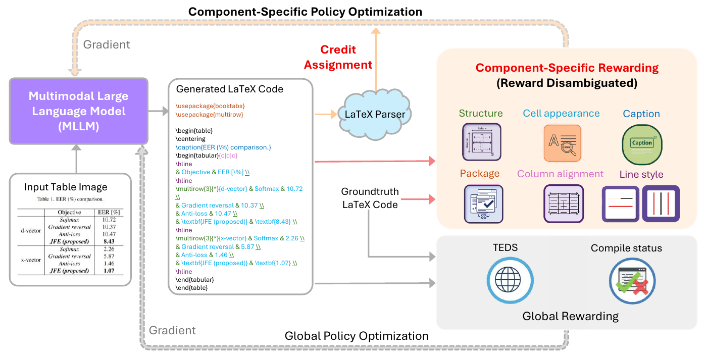

# CSPO: Alleviating Reward Ambiguity for Structured Table-to-LaTeX Generation

<div align="center">

[](https://arxiv.org/abs/2604.10918)
[](LICENSE.TXT)
[](https://huggingface.co/datasets/yunfanyang1/TableTex)
[](https://huggingface.co/yunfanyang1/Qwen2.5-VL-3B-CSPO)
[](https://huggingface.co/yunfanyang1/Qwen2.5-VL-7B-CSPO)

<h3>
ACL 2026 (Main Conference)
</h3>

<br/>

<div align="center">
  
  <br/>
</div>

</div>

## Introduction

Tables in scientific documents contain rich structured information, yet when stored as images or PDFs, their contents become difficult to edit, analyze, and reuse. Converting table images into executable LaTeX code is therefore an important step toward reliable document digitization. However, existing multimodal large language models (MLLMs) often struggle to faithfully reconstruct table structures, styles, and contents simultaneously, leading to issues such as incorrect cell merges, formatting inconsistencies, missing captions, and non-compilable LaTeX code.

This repository provides the official implementation of CSPO (Component-Specific Policy Optimization), a reinforcement learning framework for high-fidelity table image-to-LaTeX generation, built on Qwen2.5-VL-3B and Qwen2.5-VL-7B. Instead of relying on a single aggregated reward, CSPO decomposes LaTeX generation into multiple functional components, including structure, content, alignment, captions, and line styles, and assigns component-specific rewards with token-level credit assignment. This design alleviates reward ambiguity in conventional RL-based structured generation and enables more reliable and controllable optimization. Our work also introduces hierarchical evaluation metrics for assessing structure, content, style, and overall fidelity.

## Hugging Face Resources

- Dataset: [yunfanyang1/TableTex](https://huggingface.co/datasets/yunfanyang1/TableTex)
- Model: [yunfanyang1/Qwen2.5-VL-3B-CSPO](https://huggingface.co/yunfanyang1/Qwen2.5-VL-3B-CSPO)
- Model: [yunfanyang1/Qwen2.5-VL-7B-CSPO](https://huggingface.co/yunfanyang1/Qwen2.5-VL-7B-CSPO)

## Environment Setup

### Conda / Miniconda

Create and activate the CSPO environment:

```bash
conda create -n cspo python=3.12
conda activate cspo
```

### Install TeX Live

Our training and evaluation pipeline requires LaTeX compilation, such as `pdflatex`.
Please install TeX Live from the official website:

- TeX Live: [TeX Live Official Website](https://tug.org/texlive/)
- Installation Guide: [TeX Live Documentation](https://www.tug.org/texlive/doc.html)

We recommend installing the full TeX Live distribution.

On Ubuntu/Debian systems, also install the following system dependencies:

```bash
sudo apt-get update
sudo apt-get install -y ghostscript poppler-utils
```

### Install Python Dependencies

```bash
cd CSPO
bash setup.sh
```

## Data Preparation

The training and evaluation dataset is available on Hugging Face:

- [yunfanyang1/TableTex](https://huggingface.co/datasets/yunfanyang1/TableTex)

## Training

### SFT

#### Install LLaMA Factory

We use LLaMA-Factory to train the SFT model. Clone the LLaMA-Factory repository
and install its dependencies:

```bash
git clone https://github.com/hiyouga/LLaMA-Factory.git
cd LLaMA-Factory
pip install -e ".[torch,metrics]" --no-build-isolation
```

#### Run SFT Training

```bash
llamafactory-cli train ../configs/llamafactory/qwen2_5_vl_table_full_sft.yaml
```

Before training, update the following fields in
[`configs/llamafactory/qwen2_5_vl_table_full_sft.yaml`](configs/llamafactory/qwen2_5_vl_table_full_sft.yaml):

| Argument | Meaning | Example |
| --- | --- | --- |
| `model_name_or_path` | Base model path | `models/Qwen2.5-VL-3B-Instruct` |
| `media_dir` | Dataset image directory | `datasets/tabletex/` |
| `output_dir` | Output directory for the SFT checkpoint | `saves/qwen2_5_vl_sft_3b` |

### CSPO / GRPO

Before running CSPO, configure the GPT-4o API in `def _load_model` of [`src/open-r1-multimodal/src/open_r1/vlm_modules/agents/Agent.py`](src/open-r1-multimodal/src/open_r1/vlm_modules/agents/Agent.py).

CSPO:

```bash
bash run_scripts/run_cspo_table_3b.sh
```

GRPO:

```bash
bash run_scripts/run_grpo_table_3b.sh
```

Before training, update the following fields in the corresponding script:

| Argument | Meaning | Example |
| --- | --- | --- |
| `data_paths` | Training set path | `data/grpo_trainset5000.jsonl` |
| `image_folders` | Dataset image directory | `data/tabletex` |
| `model_path` | SFT model path | `saves/qwen2_5_vl_sft_3b/checkpoint-156` |

## Evaluation

### Inference

```bash
torchrun --nproc_per_node=4 src/eval/inference_CSPO.py \
  --dataset data/testset4000.jsonl \
  --image data/tabletex \
  --model_path model/3B-lora-CSPO \
  --run_name CSPO \
  --output_dir src/eval/output
```

Arguments:

| Argument | Meaning |
| --- | --- |
| `--dataset` | Test set path |
| `--image` | Dataset image directory |
| `--model_path` | Model path |
| `--run_name` | Model/run name |
| `--output_dir` | Output directory |

### TEDS and Compilation Rate

```bash
python src/eval/merge_and_eval.py \
  --run_name CSPO \
  --output_dir src/eval/output
```

Arguments:

| Argument | Meaning |
| --- | --- |
| `--run_name` | Model/run name. This should be the same as the inference stage. |
| `--output_dir` | Output directory. This should be the same as the inference stage. |

### Fine-Grained Metrics

Fine-grained metrics are evaluated with GPT-4o.

1. Configure the GPT-4o API in `def _load_model` of [`src/eval/llm_judge/agents/Agent.py`](src/eval/llm_judge/agents/Agent.py).
2. Run GPT-4o evaluation:

```bash
bash src/eval/llm_judge/run_metal_critic.sh
```

Before running, update the following fields in [`src/eval/llm_judge/run_metal_critic.sh`](src/eval/llm_judge/run_metal_critic.sh):

| Argument | Meaning | Example |
| --- | --- | --- |
| `DATASET_DIR` | Test result file from the TEDS and Compilation Rate stage | `src/eval/output/CSPO/merged.jsonl` |
| `WORKING_HOME_DIR` | GPT-4o evaluation output directory | `src/eval/llm_judge/result/CSPO` |

3. Compute the average GPT-4o scores:

```bash
python src/eval/llm_judge/get_gpt_critic.py
```

Before computing the average score, set `WORKING_HOME_DIR` in [`src/eval/llm_judge/get_gpt_critic.py`](src/eval/llm_judge/get_gpt_critic.py) to the same output directory used in the GPT-4o evaluation stage.

## Acknowledgements

This project is built upon or inspired by the following open-source projects:

- [VLM-R1](https://github.com/om-ai-lab/VLM-R1)
- [Qwen2.5-VL](https://github.com/QwenLM/Qwen2.5-VL)
- [LLaMA-Factory](https://github.com/hiyouga/LLaMA-Factory)
- [METAL](https://github.com/metal-chart-generation/metal)

## Citation

If you find this project useful, please cite our work:

```bibtex
@article{yang2026cspo,
  title={CSPO: Alleviating Reward Ambiguity for Structured Table-to-LaTeX Generation},
  author={Yang, Yunfan and Lan, Cuiling and Sang, Jitao and Lu, Yan},
  journal={arXiv preprint arXiv:2604.10918},
  year={2026}
}
```


## License

The CSPO project is licensed under the MIT License. See [LICENSE.TXT](./LICENSE.TXT).

This repository also includes or adapts third-party open-source components.
Those components remain subject to their respective licenses, as described in
[NOTICE](./NOTICE) and in the corresponding license files included in this
repository.

## Code of Conduct

This project has adopted the [Microsoft Open Source Code of Conduct](https://opensource.microsoft.com/codeofconduct/).
For more information, see the [Code of Conduct FAQ](https://opensource.microsoft.com/codeofconduct/faq/)
or contact [opencode@microsoft.com](mailto:opencode@microsoft.com).

## Security

Microsoft takes the security of our software products and services seriously.
Please do not report security vulnerabilities through public GitHub issues.
For security reporting information, locations, contact information, and policies,
review the guidance in [SECURITY.md](./SECURITY.md).

## Trademarks

This project may contain trademarks or logos for projects, products, or services. Authorized use of Microsoft trademarks or logos is subject to and must follow [Microsoft's Trademark & Brand Guidelines](https://www.microsoft.com/en-us/legal/intellectualproperty/trademarks). Use of Microsoft trademarks or logos in modified versions of this project must not cause confusion or imply Microsoft sponsorship. Any use of third-party trademarks or logos are subject to those third-party's policies.
